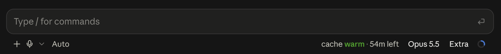
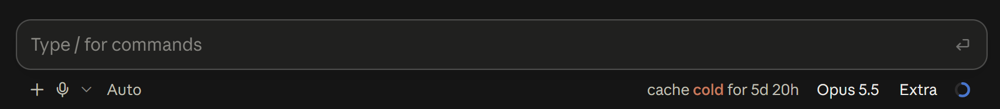
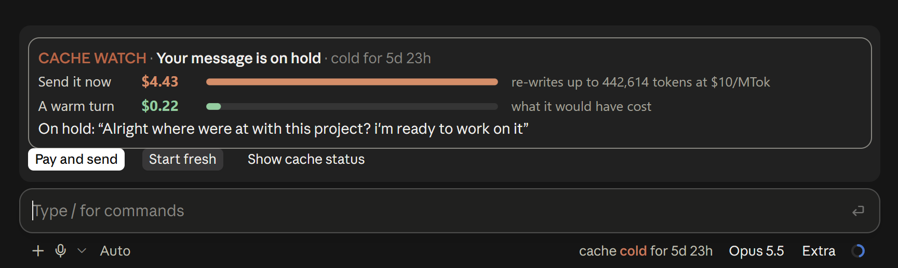

# cache-watch

A Claude Code mod that watches your prompt cache, so a message to an old conversation doesn't quietly cost you a full re-write.

It shows whether the cache is warm or cold in the prompt footer. When a send would re-write a cold cache, it holds the message and shows you the price first. And it can keep the cache warm while you're away. It's a fork of Karan Bansal's [cache-tax](https://github.com/karanb192/cache-tax), reworked for the Claude desktop app.



The footer while the cache is warm: how long it has left before it goes cold.



The same footer once the cache has gone cold.



Sending to a 442k-token conversation that went cold days ago. The message waits on a card until you choose.

## What it does

- **Footer status.** The footer next to the model picker reads `cache warm · 54m left` or `cache cold for 6m`. Warm is green, cold is orange, and the word is always there, so colour is never the only signal.
- **Hold card.** When the cache has gone cold and the conversation is big (50,000 tokens or more), your next message waits on a card above the prompt box. The card puts what sending now costs next to what a warm turn would have cost. Then you pick:
  - **Pay and send** sends it as it is. cache-watch then keeps the cache warm for 3 hours, so you don't pay the re-write twice.
  - **Start fresh** runs `/clear` and puts your message back in the prompt box for a new conversation. `/resume` still brings the old one back.
  - **Show cache status** opens the status card inside the hold card.
- **Keepwarm.** `/keepwarm` keeps the cache warm for 6 hours, with a cheap ping 55 minutes after your last request. [How it works](docs/how-it-works.md) explains what a ping is and what it costs.

The only request cache-watch makes of its own is the keepwarm ping: a one-line question over your conversation, whose reply is thrown away and never shows in the chat. It keeps a few settings in Claude Code's plugin store on your machine, listed in [the reference](docs/commands.md#what-it-stores).

## Install

Mods install from a terminal. The desktop app's Code tab doesn't offer the `/plugin` command, so run these once in PowerShell, Terminal, or any shell where `claude` works:

```bash
claude plugin marketplace add Barncore/cache-watch
```

```bash
claude plugin install cache-watch@cache-watch --scope user
```

Then restart the desktop app, or start a new `claude` session. In an interactive `claude` session you can do both steps in one line instead: `/plugin install cache-watch --marketplace Barncore/cache-watch`.

If you also have cache-tax installed, turn it off, or every cold send gets guarded twice:

```bash
claude plugin disable cache-tax@claude-code-mods
```

To update later:

```bash
claude plugin marketplace update cache-watch
```

```bash
claude plugin update cache-watch@cache-watch --scope user
```

Then restart the app again. A running session keeps the copy it started with.

### What it needs

- **Claude Code 2.1.287 or later.** That's the release mods arrived in. They're on by default, but local settings, safe mode or an organisation policy can turn them off. See [Anthropic's mod docs](https://code.claude.com/docs/en/plugins/mods/overview#turn-mods-on-or-off).
- **A one-hour prompt cache.** A Claude subscription gets one by default. API-key, usage-credit and cloud-provider sessions default to five minutes, and no ping schedule can save a five-minute cache. On those, set [`promptCacheTtl`](https://code.claude.com/docs/en/prompt-caching#choose-the-ttl-yourself) to `"1h"`. (Credit to cache-tax's README for spelling this out.)
- **Claude Code left running, for keepwarm.** Pings come from a timer inside Claude Code. A closed app or a sleeping PC sends none.

## Tested on

- **Windows 11, the Claude desktop app's Code tab, Claude Code 2.1.295.** This is the only setup cache-watch has been run on by a person looking at the screen.
- **macOS: untested.** It should work. Mods are JavaScript run by Claude Code itself, and cache-watch touches no files, processes or OS features, so nothing in its code is Windows-specific. But the desktop app draws mods itself, and a few mod drawing bugs have only been reported on Mac. If you try it on a Mac, an issue saying how it went would really help.
- **Terminal: covered by the tests, not watched live.** The tests draw the status row and the hold card for a terminal, but not the footer, and nobody has looked at any of it in a real terminal yet.
- **The footer is the newest part.** It was checked on 2.1.295, and mod support changes fast between releases. If your build draws it oddly, `/cache-watch footer off` moves the status back above the prompt box.

## Commands

| Command | What it does |
|---|---|
| `/keepwarm` | Keep the cache warm for 6 hours |
| `/keepwarm 90m` | Keep it warm for a window of your own (`2h30m`, `45m`) |
| `/keepwarm always` | Start a 6-hour window in every session, until `/keepwarm off` |
| `/keepwarm status` | Time left in the window, next ping, last ping's cost |
| `/keepwarm off` | Stop, and turn `always` off |
| `/cache-watch` | The status card: state, context size, cold cost, keepwarm, this session's cold writes |
| `/cache-watch pay` | Same as the Pay and send button |
| `/cache-watch fresh` | Same as the Start fresh button |
| `/cache-watch preview` | Show the hold card with this session's numbers, without holding anything |
| `/cache-watch guard warn` | Don't hold cold sends; only show the price |
| `/cache-watch guard refuse` | Hold cold sends again (the default) |
| `/cache-watch footer off` | Move the status back above the prompt box (`on` moves it to the footer) |

The buttons have command twins on purpose. In the desktop app a click can get lost while any mod redraws, and the commands always land. Every command and every label is in [the command reference](docs/commands.md).

## What's different from cache-tax

- **The hold card.** cache-tax drops a cold send once and shows the price as text, and you send again to pay. cache-watch holds it on a card with the price drawn and three choices. Sending the same message again still pays, as before.
- **It draws in the desktop app.** cache-tax decides when the session starts whether it can draw above the prompt. In the desktop app the Code tab connects a moment later, so cache-tax never draws its band there. cache-watch checks each time it draws.
- **The footer.** The status lives in the prompt footer and shows all the time, not only while keepwarm runs.
- **55-minute pings** instead of 50. That saves one ping in a 6-hour window and still leaves 5 minutes of slack before the hour runs out. [Why 55](docs/how-it-works.md#why-55-minutes).
- **`/cache-watch`** instead of `/cache-tax`.

Everything else is cache-tax's: the guard's logic, keepwarm, the cost maths and the price table.

## Docs

- [How it works](docs/how-it-works.md): the prompt cache, what a cold send costs, what a ping is, why 55 minutes, and why you wouldn't keep it warm all the time.
- [Command reference](docs/commands.md): every command, footer label and status card line, what's stored, and what the mod can reach.
- [Development](docs/development.md): running it from a checkout, tests, type-checking, and making a release.

## Licence

MIT, see [LICENSE](LICENSE). cache-watch is built on [cache-tax](https://github.com/karanb192/cache-tax) by Karan Bansal, also MIT, and his copyright notice is kept.
